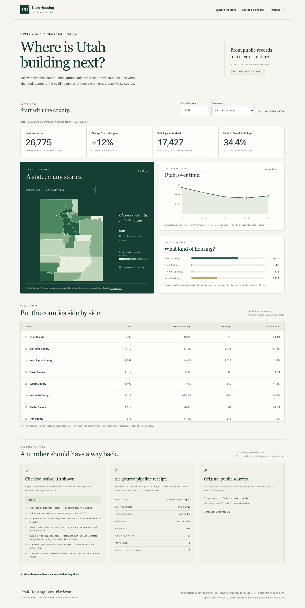
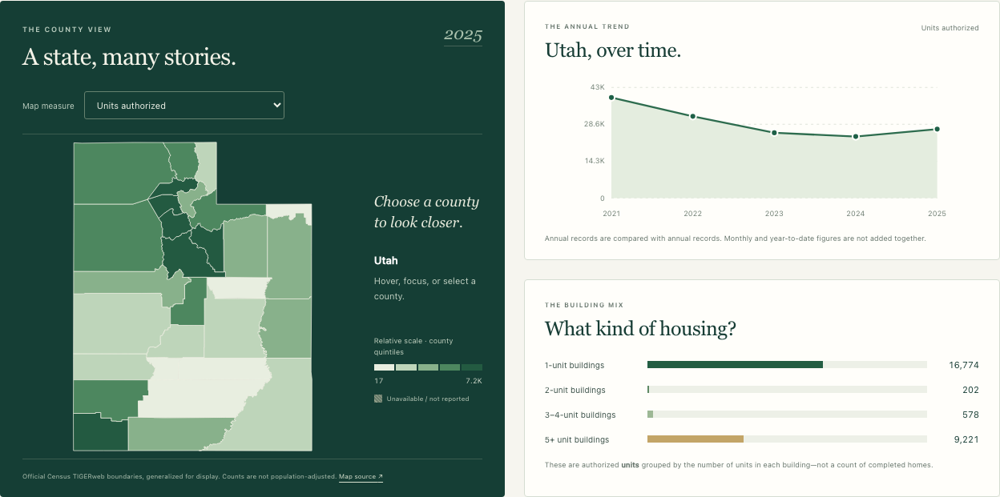
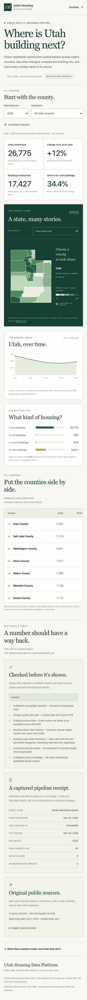
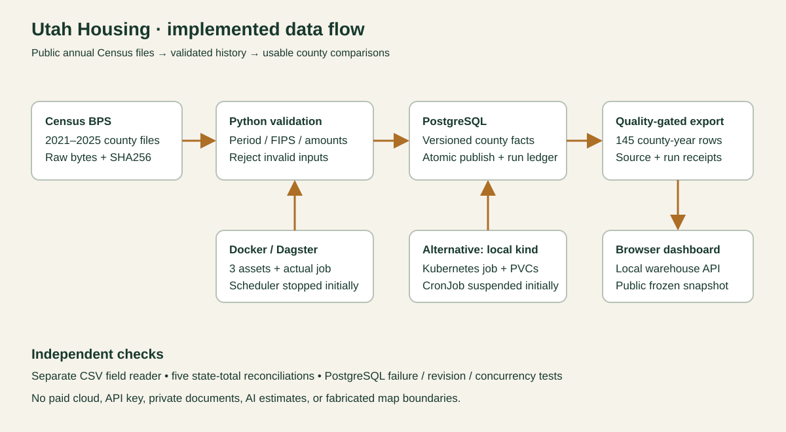
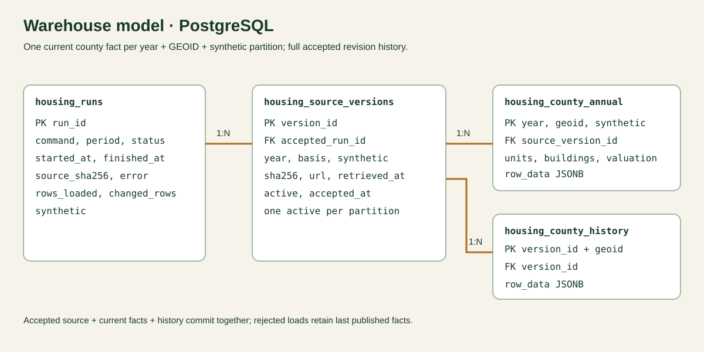

# Utah Housing Data Platform

[](https://github.com/bronson-12o/utah-housing-platform/actions/workflows/checks.yml)

**How is housing construction changing across Utah’s 29 counties?** This project turns public Census building-permit files into a versioned PostgreSQL warehouse and an interactive county dashboard. Follow a number from the map back to the original file, its fingerprint, and the run that loaded it.

[Explore the dashboard](https://bronsonhatch.com/utah-housing/) · [Verification evidence](docs/verification/README.md) · [Source and metric guide](docs/SOURCES.md)



<details>
<summary>County detail and phone views</summary>





</details>

## What you can explore

- Five annual reference years, **2021–2025**, covering **145 county-year records**.
- Authorized housing units, annual change, and the share in buildings with five or more units.
- County map, linked comparison table, annual trend, building mix, original source records, and actual pipeline receipts.
- A public frozen snapshot that works without an account, API key, backend, or external chart service.

These are **units authorized by building permits**, not completed homes, listing prices, rents, or an AI housing forecast. The public dashboard is a dated snapshot; it does not run your local jobs.

## Run it locally

Requirements: Docker with Compose, Python 3.12+, internet for the first image/source download, and available local ports. No cloud account or paid API is needed. The scripts generate a private local database password; do not commit `.env`.

```bash
git clone https://github.com/bronson-12o/utah-housing-platform.git
cd utah-housing-platform
python3 scripts/local.py up
```

Open **http://127.0.0.1:8087** for the warehouse-backed dashboard and **http://127.0.0.1:3007** for Dagster. Initial setup builds the image, starts PostgreSQL, validates and loads five annual files, exports a snapshot, and starts the services. Persistent volumes keep the data between restarts.

```bash
python3 scripts/local.py check      # check real warehouse quality
python3 scripts/local.py refresh    # fetch sources again; unchanged bytes are no-ops
python3 scripts/local.py snapshot   # update web/data/housing.json for review/publication
python3 scripts/local.py fixture    # separate database; explicitly synthetic dashboard on :8088
python3 scripts/local.py stop       # stop only this Compose project; retain its volumes
```

The fixture requires no Census download; the first Docker image build still needs internet. Real and synthetic records are isolated by database and explicit partition. Synthetic examples never enter the public snapshot.

## Architecture



| Layer | Implementation | Why it is here |
| --- | --- | --- |
| Source | Census BPS annual county CSV-text files | Original public records, no API key |
| Validation | Python, strict schema/period/FIPS/amount checks | Reject malformed data rather than invent values |
| Warehouse | PostgreSQL 17 | Transactions, revision history, constraints, run ledger |
| Orchestration | Dagster OSS in Docker Compose | Three assets, a materialization job and an asset quality check |
| Alternative execution | Local kind Kubernetes | Persistent warehouse, manual Jobs, a suspended CronJob |
| API | FastAPI | Read-only current data, source receipts and run receipts |
| Presentation | HTML, CSS, JavaScript and SVG | Portable dashboard and actual Census county geometry |
| CI | GitHub Actions + isolated PostgreSQL | Parser, API and actual warehouse regression checks |

Dagster and Kubernetes are **alternative local execution paths**. This project does not pretend to need a paid distributed cluster for 145 rows. Kubernetes demonstrates deployment, readiness, persistent storage, retries and recovery on the same implementation.

## What makes the numbers reviewable

Every accepted source has a URL, retrieval timestamp and SHA256. Current county facts and history publish in one transaction. Concurrent loads serialize by period; unchanged bytes do not duplicate records; known superseded content and older observations cannot overwrite a newer accepted revision. Export writers serialize the complete snapshot-to-file operation and replace the target atomically.

The static dashboard also checks the exported records against their annual source receipts before displaying them. Contradictory periods, fingerprints, counts or validation receipts are withheld. An honest `needs_attention` export keeps unknown values visible as unknown.

An independent standard-library CSV reader makes **1,305 value, name and fingerprint comparisons** across all 145 rows without importing the application parser. Annual county unit sums also reconcile to five separately published state files. State valuation is reported in thousands of dollars, so its rounding differences are recorded instead of forced to zero.

```bash
python3 scripts/verify_snapshot.py                 # independent live-source reconciliation
python3 scripts/verify_snapshot.py --offline       # structure/receipt consistency only
```

If Census changes a file, the independent check fails against the older published fingerprint. Refresh, inspect the new source version and diff, verify again, then publish the replacement snapshot. This is measured verification of a bounded dataset, not a promise that every future source is correct.



## Try Kubernetes locally

Install the free [kind CLI](https://kind.sigs.k8s.io/docs/user/quick-start/) and a compatible `kubectl`. Keep Docker running. Build the application first with the Compose command above, then:

```bash
python3 scripts/kubernetes.py up
python3 scripts/kubernetes.py status
python3 scripts/kubernetes.py forward
# dashboard: http://127.0.0.1:18087
```

The launcher creates only the named `utah-housing-platform` kind cluster. It uses its own ignored kubeconfig under `data/kubernetes/`, explicit context and namespace, and a generated local Secret. It does not switch your normal Kubernetes context or contact a cloud cluster. Images are pinned; the application uses the locally built image. `refresh` starts a manual load Job. The monthly CronJob is suspended and the Dagster schedule is stopped initially.

## Development and tests

```bash
python3 -m venv .venv
. .venv/bin/activate
pip install -r requirements.lock
pip install --no-deps -e .
python -m pytest -q
```

Without `TEST_DATABASE_URL`, actual PostgreSQL tests explicitly skip. For a full run, point that variable at a disposable PostgreSQL database whose name contains `test` or `fixture`. Each test uses a unique schema and removes only that schema. GitHub Actions provisions a separate test database and runs these checks. Never point tests at a user database. The lock was verified on macOS/Linux with Python 3.12; native Windows is not claimed (use Docker).

Optional [browser regression checks](docs/verification/README.md#optional-browser-regression-checks) exercise the actual dashboard in Chromium and WebKit, including malformed exports, missing values, retry behavior, keyboard controls and exact JSON downloads. Playwright is a development tool and is not needed to run the app.

## Limits and practical tradeoffs

- Coverage is annual Census permit authorizations for 2021–2025. Source revisions may change previously reported figures.
- Permit valuation describes permitted construction, not market value. The primary counts and valuations include survey estimates; reported-only figures remain separate. Missing source values remain missing and block a publishable export.
- TIGERweb supplies actual county geometry, generalized for browser performance. It is not a parcel or navigation map.
- The public site has a frozen data/run receipt; it exposes no database credentials, write endpoints or private property documents.
- A force-killed process can leave a ledger row marked `running`. PostgreSQL rolls back its uncommitted changes; automatic abandoned-run reconciliation is not implemented.
- Source retrieval timestamps order observations; they are not a Census-published revision sequence.
- No home prices, demographic joins, forecasting model, streaming stack or cloud-scale performance claims are included. Those need separate sources and validation.

Built by Bronson Hatch with AI coding agents for implementation and independent review. Data verification uses original source files and explicit regression cases. The documentation layout was inspired by [practical-data-engineering](https://github.com/ssp-data/practical-data-engineering); this is an original implementation. See [rights and attribution](RIGHTS.md).
